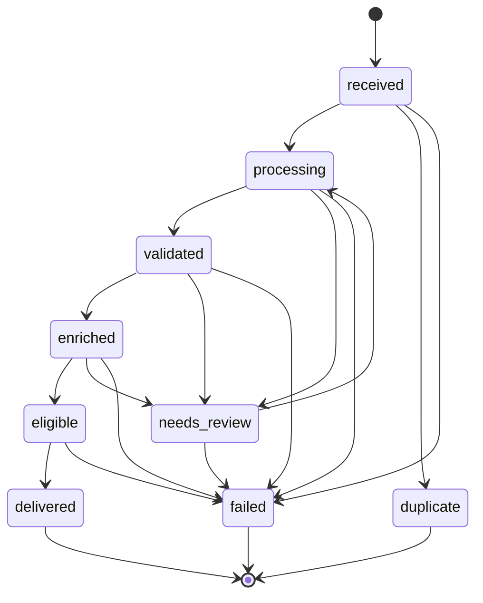

# Architecture — NewNews

## 1. Overview: modular monolith

One repository, **one container image**, **two long-running processes** plus Postgres (and a
one-shot migration command):

| Compose service | Command | Role |
|---|---|---|
| `db` | `postgres:17-alpine` | System of record: domain tables + job queue + audit |
| `migrate` | `alembic upgrade head` | One-shot; `api`/`worker` wait for it (`service_completed_successfully`) |
| `api` | `uvicorn app.api.main:app --host 0.0.0.0 --port 8000` | HTTP: ingestion, retrieval, SSE, admin, health |
| `worker` | `python -m app.worker` | Claims jobs, executes pipeline stages |

Stages are separated by **module boundaries, not network calls**. The same image runs every
service; only the command differs (see ADR-0005).

## 2. Pipeline flow

```
 POST /api/v1/items ──► news_items(status=received) + audit(received)
                        + pipeline_jobs(stage=extract, pending)
        │
        ▼   worker loop (claim FOR UPDATE SKIP LOCKED; idle poll 200 ms)

  extract ──► validate ──► enrich ──► match
     │            │           │          │
 processing    validated   enriched    eligible
               └─ needs_review ◄┘          │  deliveries(pending) per matched client
                   (stops; no deliveries)  │
        │                                  │
        ▼                                  ▼
   GET /api/v1/events  (SSE, 200 ms poll)  or  GET /api/v1/news?ack=true  (REST)
        └──────────────► delivered ◄──────────┘
                          audit(delivered, latency_ms)
```

Each stage is a separate job row. A handler returns the *name of the next stage* (or `None` to
stop), and the worker enqueues it in the same transaction that marks the current job
`succeeded` — so a crash between stages cannot lose an item.

Failure path: stage exception → job retried with exponential backoff → after 3 attempts the job
is `dead` and the item becomes `failed`.

## 3. Process boundaries

| Concern | `api` process | `worker` process |
|---|---|---|
| Entry point | `app/api/main.py` (`create_app`) | `app/worker/main.py` (`main`, `python -m app.worker`) |
| Does | HTTP validation, auth, ingestion (writes `news_items` + first job), REST/SSE delivery, admin, health | Claims jobs, runs `extract/validate/enrich/match`, retries, dead-letters |
| Does **not** | Run pipeline stages | Serve HTTP; the SSE/REST paths live only in `api` |
| Shared | `app/core` (config, db, logging, security, context), `app/models`, `app/pipeline` — same code, same image |
| Scaling | Uvicorn process(es) | Multiple workers are safe: `SKIP LOCKED` claims are exclusive; `worker_id = hostname:pid` |

Cross-process communication is **only through Postgres**: job rows (api → worker) and delivery
rows (worker → api). M1 notify is polling; M3 upgrades it to `LISTEN/NOTIFY` (§10).

## 4. Module map

| Module | Responsibility |
|---|---|
| `app/api/main.py` | App factory, router mounting (`/api/v1` prefix), `RequestContextMiddleware` (pure ASGI) |
| `app/api/routers/ingest.py` | `POST /api/v1/items` — idempotent ingestion, dedupe + race handling, enqueues first stage |
| `app/api/routers/news.py` | `GET /api/v1/news` (pull feed + `ack`), `GET /api/v1/items/{id}` (detail) |
| `app/api/routers/events.py` | `GET /api/v1/events` — SSE stream, `Last-Event-ID` resume, heartbeats, delivery → `sent` |
| `app/api/routers/clients.py` | `POST /api/v1/clients` (admin mint), `GET /api/v1/clients/me` |
| `app/api/routers/health.py` | `/healthz`, `/readyz` |
| `app/api/deps.py` | API-key extraction, `get_current_client`, `require_admin` |
| `app/api/schemas.py` | Pydantic request/response models (validation limits, `ItemOut`, …) |
| `app/core/config.py` | `Settings` (pydantic-settings, `.env`): thresholds, poll intervals, provider, keys |
| `app/core/db.py` | Async engine, `SessionLocal`, `get_session` / `session_scope`, `ping_db` |
| `app/core/context.py` | Correlation-ID contextvar (`get/set/new_correlation_id`) |
| `app/core/logging.py` | JSON `JsonFormatter`, `setup_logging`, whitelisted record extras |
| `app/core/security.py` | API-key generation (`nn_` + prefix + secret), SHA-256 hashing, `hmac.compare_digest` verify |
| `app/models/*` | SQLAlchemy 2.0 models: `news_items`, `media_assets`, `pipeline_jobs`, `clients`, `subscriptions`, `deliveries`, `audit_events` (see `docs/data-model.md`) |
| `app/pipeline/states.py` | `ItemStatus`, transition table, `transition()`, terminal states |
| `app/pipeline/hashing.py` | Text normalization + content hash (idempotency key) |
| `app/pipeline/extraction.py` | Stage `extract`: normalize body, language detection, empty-body → `failed` |
| `app/pipeline/validation.py` | Stage `validate`: credibility assessment + routing thresholds |
| `app/pipeline/enrichment.py` | Stage `enrich`: topics, locations, urgency, summary |
| `app/pipeline/matching.py` | Stage `match`: pure `subscription_matches()` rule + delivery fan-out |
| `app/pipeline/queue.py` | `enqueue_job`, `claim_job` (`FOR UPDATE SKIP LOCKED`), `reschedule_job` |
| `app/pipeline/runner.py` | Stage registry (`extract/validate/enrich/match`), `STAGE_ORDER`, `FIRST_STAGE` |
| `app/pipeline/audit.py` | `record_audit()` — one audit row per stage outcome |
| `app/pipeline/ai/base.py` | `AIProvider` protocol + `CredibilityAssessment` / `Classification` dataclasses, urgency ranks |
| `app/pipeline/ai/stub.py` | Deterministic heuristic provider (offline, explainable) |
| `app/pipeline/ai/factory.py` | `get_provider()` — `AI_PROVIDER=stub|groq` switch (lru-cached) |
| `app/worker/main.py` | Poll loop, `process_next`, `_handle_failure` (retry / dead-letter), `drain` (tests) |
| `app/seed.py` | `python -m app.seed` — demo client + subscription, prints key once |
| `alembic/` | Migrations (`env.py` reads `DATABASE_URL` from app settings) |
| `tests/` | Unit tests (offline) + integration tests (need `TEST_DATABASE_URL`) |

## 5. Postgres job queue

Table `pipeline_jobs` with index `ix_jobs_claim (status, run_at)`.

**Claim** (single statement, in `app/pipeline/queue.py`):

```sql
UPDATE pipeline_jobs
   SET status = 'running', locked_by = :worker_id, locked_at = now(),
       attempts = attempts + 1, updated_at = now()
 WHERE id = ( SELECT id FROM pipeline_jobs
               WHERE status = 'pending' AND run_at <= now()
               ORDER BY run_at, created_at
               FOR UPDATE SKIP LOCKED
               LIMIT 1 )
 RETURNING id
```

`SKIP LOCKED` lets multiple worker processes race without blocking each other; the claim is
committed immediately so the row lock is held only briefly.

**Completion / retry / dead-letter** (`app/worker/main.py`):

| Outcome | Job mutation |
|---|---|
| Stage handler returns | `status = 'succeeded'`; next-stage job enqueued in the same transaction |
| Stage raised, `attempts < max_attempts` | `status = 'pending'`, `run_at = now + JOB_RETRY_BASE_SECONDS (5) · 2^(attempts−1)` → 5 s, 10 s, 20 s; `last_error` (truncated to 4000 chars); lock columns cleared |
| Stage raised, `attempts >= max_attempts` (3) | `status = 'dead'`; item → `failed` (transition skipped if already terminal); audit `job_dead` |

Idle wait between claims is `WORKER_POLL_INTERVAL_MS` (200 ms). Jobs are ordered by
`run_at, created_at`, so backoff naturally defers retried work.

## 6. Item state machine



The table in `app/pipeline/states.py` (`TRANSITIONS`) is authoritative; `transition()` raises
`InvalidTransition` for anything else. Entering `eligible` sets `eligible_at` (once); entering
`delivered` sets `delivered_at` (once) — these two timestamps define the NFR-01 latency metric.

Branches:

- `duplicate` — reserved by the state machine; in M1 dedupe happens *before* insert (the API
  returns the existing row with `duplicate: true`), so no item row is ever placed in this state.
- `needs_review` — low credibility/confidence (validate) or nothing to match (enrich). Terminal
  for automation; a later manual re-entry to `processing` is allowed by the table but has no UI
  or API in M1.
- `failed` — empty body, or a job that exhausted its 3 attempts.

## 7. Delivery model

One `deliveries` row per `(item_id, client_id)` (unique constraint), created by the `match`
stage with `status = 'pending'`. The bigint identity primary key **is** the SSE event id.

| Path | Read | Ack (pending → sent) |
|---|---|---|
| **SSE** `GET /api/v1/events` | `status='pending' AND id > cursor`, ordered by id, 200 ms poll | Set by the stream itself before yielding: `channel='sse'`, `sent_at`, audit `delivered` with `latency_ms`, item `eligible → delivered` (first ack only), then `id: <delivery_id>` is emitted |
| **REST** `GET /api/v1/news` | `id > since_id`, any status, newest first | Opt-in: `ack=true` flips returned `pending` rows with `channel='rest'` and moves an `eligible` item to `delivered` |

Notes:

- Status vocabulary is only `pending | sent` in M1 — there is no per-delivery failure state; a
  client that missed an event recovers by calling `GET /api/v1/news` (it returns sent rows too).
- Item status `delivered` reflects the **first** confirmed receipt; per-client receipt is tracked
  row-by-row in `deliveries`.
- Resume: the cursor starts at 0, or at `Last-Event-ID` (header) / `last_event_id` (query). Only
  still-`pending` rows above the cursor are sent, so a redelivered connection never re-sends an
  event it already acked.
- Ordering caveat: a delivery is flipped to `sent` *before* its frame is written; if the
  connection dies in between, SSE will not replay that event (at-most-once on the stream).
  Recovery is always possible through `GET /api/v1/news`, which returns sent rows too — the
  durable record, not the stream, is the source of truth.

## 8. Correlation-ID propagation

1. `RequestContextMiddleware` (pure ASGI — deliberately **not** `BaseHTTPMiddleware`, which
   buffers responses and would break SSE streaming) reads `X-Correlation-ID` or generates a UUID
   hex, stores it in a `contextvars.ContextVar` (`app/core/context.py`), and echoes it in the
   `x-correlation-id` response header.
2. Every request emits one structured JSON log line with method, path, status, `duration_ms`,
   `correlation_id`.
3. Ingestion persists the id on `news_items.correlation_id`; `record_audit()` copies it onto
   every `audit_events` row, so ingest → stages → delivery can be joined end-to-end in SQL.
4. `JsonFormatter` falls back to the contextvar for any log line that does not pass an explicit
   `correlation_id`.

Note: only the API process seeds the contextvar. Worker log lines fall back to the default `-`;
the joinable record of a worker stage is its `audit_events` row (and `news_items.correlation_id`),
which always carry the real id.

## 9. AI provider interface

`AIProvider` is a `typing.Protocol` (`app/pipeline/ai/base.py`) — the pipeline depends only on:

| Method | Returns |
|---|---|
| `assess_credibility(text)` | `CredibilityAssessment(score, confidence, status, rationale[])` |
| `classify(text)` | `Classification(topics[], urgency)` |
| `summarize(text)` | `str` |
| `detect_locations(text)` | `list[str]` |
| `translate(text, src, tgt)` | `str` (M2) |

`get_provider()` (lru-cached) selects the implementation from `AI_PROVIDER`:

- **`stub` (default, M1)** — deterministic heuristics: base score 0.55 adjusted by length,
  date/location/source-attribution evidence (+) and clickbait, ALL-CAPS, exclamation density
  (−), clamped to 0–1; confidence adjusted by length and concrete evidence; every adjustment is
  emitted as a rationale string and persisted on the item. Topic/urgency keyword lexicons cover
  English + Devanagari terms; locations are a fixed Nepali place list. Same input → same output.
- **`groq` (M2)** — raises `NotImplementedError` today; will implement the same protocol via the
  OpenAI-compatible SDK (see ADR-0004).

Routing thresholds: `validation.py` passes an item only when
`score >= CREDIBILITY_VERIFIED_THRESHOLD` (settings, **0.75**) **and**
`confidence >= MIN_ROUTING_CONFIDENCE` (module constant, **0.4**); otherwise → `needs_review`.
`CREDIBILITY_REVIEW_THRESHOLD` (**0.45**) is defined in settings as the lower label band; the
stub currently hardcodes its 0.75/0.45 status bands inline. **Outputs are assessments with
evidence and confidence, never proof of truth.**

## 10. M3 upgrade path: `LISTEN/NOTIFY`

M1 uses DB polling everywhere:

| Poller | Interval | Setting |
|---|---|---|
| Worker idle loop (no job to claim) | 200 ms | `WORKER_POLL_INTERVAL_MS` |
| SSE stream (new deliveries) | 200 ms | `SSE_POLL_INTERVAL_MS` |

Planned for M3: the `match`/ingestion path issues `pg_notify(channel, payload)` and the SSE
handler holds a dedicated listener connection, waking on notification instead of polling every
200 ms (polling retained as a fallback so no event can be missed). This removes up to 200 ms of
the latency budget and cuts per-connection DB load; no schema change is required because
`deliveries` remains the source of truth and `Last-Event-ID` resume works unchanged. Also in
M3: the p50/p95/p99 latency harness that measures the `eligible_at → SSE receipt` metric.
