# Roadmap — NewNews

The project's plan and progress live here (the README stays descriptive). Status as of
**2026-10-16**: M0–M2 complete · **M4 (cloud deployment) in progress** · M3 slimmed per
ADR-0007 · M5 not started.

Legend: `[x]` done · `[~]` in progress / partially done · `[ ]` not started.

## Progress at a glance

```mermaid
flowchart TB
    classDef done fill:#dcf5e3,stroke:#1a7f37,color:#0a3d1c
    classDef here fill:#fff3cd,stroke:#d97706,stroke-width:2px,color:#5b3a00
    classDef todo fill:#f1f3f5,stroke:#868e96,color:#495057

    M0["<b>M0 · Docs &amp; decisions</b> — ✅ DONE<br/>requirements · architecture · data-model · roadmap<br/><b>ADR-0001</b> Python/FastAPI &nbsp;·&nbsp; <b>ADR-0002</b> PostgreSQL<br/><b>ADR-0003</b> Postgres job queue &nbsp;·&nbsp; <b>ADR-0004</b> Groq behind provider interface<br/><b>ADR-0005</b> one image, two processes &nbsp;·&nbsp; <b>ADR-0006</b> REST + SSE (not WebSockets)"]:::done

    M1["<b>M1 · Runnable vertical slice</b> — ✅ DONE (verified 2026-10-14)<br/>ingest → extract → validate → enrich → match → SSE in <b>117 ms</b><br/>state machine · SKIP LOCKED queue · API-key auth · audit trail<br/><b>FR-01…FR-12</b> · 42 tests · <code>docker compose up --build</code>"]:::done

    subgraph M2G["<b>M2 · Real AI + media</b> — ✅ COMPLETE (2026-10-15), 77 tests"]
        direction LR
        W1["<b>W1</b> Groq AI ✅<br/>structured output,<br/>TTL cache, ne↔en<br/><b>ADR-0004</b>"]:::done
        W4["<b>W4</b> Near-dup ✅<br/>shingle + Jaccard<br/><b>FR-13</b>"]:::done
        W5["<b>W5</b> Review queue ✅<br/>approve / reject<br/><b>FR-14</b>"]:::done
        W23["<b>W2/W3</b> Media ✅<br/>upload + extract_media:<br/>PDF→OCR (mojibake too),<br/>image OCR, Whisper<br/><b>FR-15</b><br/>⏳ live Whisper test<br/>needs an audio clip"]:::done
    end

    M3["<b>M3 · Hardening</b> — ⬜ SLIMMED (ADR-0007)<br/>dead-job visibility · latency as a one-shot SQL query<br/>⛔ deferred: LISTEN/NOTIFY, percentile harness, dashboards"]:::todo

    M4["<b>M4 · Deployment (Render)</b> — 🟡 IN PROGRESS — <b>you are here</b><br/>api deployed (newnews-t54x.onrender.com), auto-deploy on push<br/>✅ env vars + pre-deploy migrate + healthcheck (Render API)<br/>⬜ DATABASE_URL → remote Postgres (Aiven hostname expired → new service)<br/>⬜ worker service from the same image · ⬜ remote E2E verification<br/>⬜ ephemeral disk → S3-compatible object storage"]:::here

    M5["<b>M5 · Mobile (Expo / React Native)</b> — ⬜ REMAINS<br/><code>mobile/</code> app: submit text + camera photo via ingest API<br/>combined multipart ingest (item + media in one request)"]:::todo

    M0 ==> M1 ==> M2G ==> M3 ==> M4 ==> M5
```

Legend: ✅ done & verified · 🟡 in progress · ⬜ not started · ⏳ waiting on input · ⛔ deferred by decision.
FR numbers = `docs/requirements.md` · ADR numbers = `docs/decisions/` · W numbers = workstreams inside M2.

---

## M0 — Documentation & architecture — **mostly complete**

- [x] Inspect repository and environment
- [x] Verify external claims (Groq free tier, Render Docker support, FastAPI versions, SQLite concurrency, Hangfire storages)
- [x] Decide stack and record rejected alternatives
- [x] Write README with plan and decisions
- [x] `docs/requirements.md`, `docs/architecture.md`, `docs/data-model.md`, `docs/roadmap.md`
- [x] ADR-0001 … ADR-0006 in `docs/decisions/`
- [x] `.gitignore`, `.env.example`

---

## M1 — Runnable vertical slice — **complete**

### Completed

- [x] **Scaffold**: uv/`pyproject.toml` (Python ≥ 3.13), FastAPI app factory, SQLAlchemy 2.0
  async + `psycopg`, Alembic env reading `DATABASE_URL` from settings, pydantic-settings `.env`
  config, ruff/pytest config
- [x] **Data model**: `news_items`, `media_assets`, `pipeline_jobs`, `clients`, `subscriptions`,
  `deliveries`, `audit_events` (documented in `docs/data-model.md`)
- [x] **State machine + job queue**: `states.py` transitions with `InvalidTransition`;
  `FOR UPDATE SKIP LOCKED` claims, exponential backoff (5 s base), dead-letter after 3 attempts
- [x] **Ingestion API**: `POST /api/v1/items` — API-key auth, content-hash idempotency,
  202/200 duplicate semantics, race handling, correlation IDs, audit `received`
- [x] **Stub pipeline end-to-end**: `extract → validate → enrich → match` with deterministic
  offline AI (credibility score/confidence/status/rationale, topics, locations, urgency,
  summary) and routing to `validated` / `needs_review` / `failed`
- [x] **Matching + delivery**: subscription rules (exclusions, topic/location axes, urgency
  gate), REST retrieval (`GET /api/v1/news` with `since_id`/`ack`, `GET /api/v1/items/{id}`),
  SSE (`GET /api/v1/events`) with `Last-Event-ID` resume, 200 ms poll, 15 s heartbeats
- [x] **Admin client minting**: `POST /api/v1/clients` (admin key, key shown once),
  `GET /api/v1/clients/me`, `python -m app.seed` demo seeder
- [x] **Tests**: 9 test modules; `42 passed` with `TEST_DATABASE_URL` set (37 unit + 5
  integration), offline/CI runs skip the integration tests; coverage includes hashing, states,
  stub AI determinism, matching rules, security, API smoke, audit trail, full happy path;
  runs on the host and inside the container (`docker compose exec api pytest`)
- [x] **Build assets written**: `Dockerfile` (python:3.13-slim + ffmpeg + tesseract with `nep`,
  dev deps included for in-container tests), `docker-compose.yml` (`db`, `migrate`, `api`,
  `worker`, healthchecks, volume; compose DB published on host port 5433 to avoid clashing
  with the local PostgreSQL used for host-side tests)

### Verification (2026-10-14)

- [x] **Docker installed on host**: Docker 29.1.3 + Compose 2.40.3; PostgreSQL 16 installed
  locally for migrations/integration tests (databases `newnews`, `newnews_test`)
- [x] **Alembic initial revision** generated via autogenerate and applied (`alembic upgrade head`,
  7 tables); Compose `migrate` service exits 0 on every `up`
- [x] **Container verification**: `docker compose up --build` → `api`, `worker`, `db` all
  **healthy**; `ffmpeg -version` → 7.1.5; `tesseract --list-langs` → `eng`, `nep`, `osd`
- [x] **Live end-to-end**: seeded client → `POST /api/v1/items` (202) → worker ran all four
  stages → SSE subscriber received the enriched item **117 ms after `eligible_at`** (budget < 2 s)
- [x] **Guardrails live-checked**: duplicate resubmission → `200` + `duplicate: true` (same id);
  missing API key → `401`; low-confidence text → `needs_review` with zero deliveries (test)
- [x] **Full test suite inside the container**: `42 passed`
- [x] **Docs sync pass**: README acceptance wording corrected (duplicates return the existing
  item instead of a `duplicate` status), README §3 tree and §5 setup validated, ADRs written

### Acceptance criteria (original M1 plan)

- [x] `docker compose up --build` brings up healthy `api`, `worker`, `db` with no host installs of ffmpeg/tesseract
- [x] Submit a text news item via Swagger/curl → it flows through all stages → matched client receives it via SSE in < 2 s after eligibility (measured 117 ms)
- [x] Duplicate submissions return the existing item (`200` + `duplicate: true`) without a second pipeline run; low-confidence items go to `needs_review`; stage failures go to `failed` — unverified content is never surfaced as news
- [x] ffmpeg and Tesseract (with Nepali data) verified inside the container
- [x] `pytest` passes; docs synchronized with implementation

---

## M2 — Real AI + media extraction — **complete 2026-10-15**

- [x] Groq integration behind the provider interface (landed 2026-10-14, `AI_PROVIDER=groq`):
  single structured-output (json_schema) call per text + in-process TTL cache (validate→enrich
  = 1 API call), score/confidence/rationale/topics/locations/urgency/summary, ne ↔ en
  translation; live smoke tests auto-skip without a key; verified E2E on a real Nepali article
  (score 0.45 "uncertain" → `needs_review` with a 5-point rationale — human-in-the-loop path)
- [x] Near-duplicate detection (landed 2026-10-15, `app/pipeline/dedupe.py`, stage between
  `extract` and `validate`): token 3-gram shingles + Jaccard over a bounded candidate window
  (`NEARDUP_*` settings — 90 d / 2000 candidates / suspect 0.6 / hard 0.85); ≥ 0.85 →
  `duplicate` + `is_duplicate_of` + audit `near_duplicate`; 0.6–0.85 → `near_duplicate_suspect`
  audit, pipeline continues; body-first scoring so reworded headlines don't hide matching copy.
  Verified: reworded cross-source copy of an existing article → `duplicate`, distinct articles
  untouched (integration tests)
- [x] Editorial review queue (landed 2026-10-15, `app/api/routers/review.py`, admin-only):
  `GET /api/v1/review` (queue) · `GET /api/v1/review/{id}` (item + full audit timeline) ·
  `POST …/approve` (`note?`) → `needs_review` → `validated`, pipeline resumes at **enrich**
  (the editor's verdict *is* validation — re-scoring would not change) · `POST …/reject`
  (`reason` required) → new terminal state `rejected`. Every decision audited; wrong state →
  409; non-admin → 403. Verified end-to-end: neutral text held in review → approved →
  enriched → matched → delivered to the client feed; rejected item terminal with reason
- [x] Media upload + extraction (landed 2026-10-15, W2/W3): `POST /api/v1/items/{id}/media`
  (multipart, client-key auth, attach while `received`, 20 MB cap, MIME+extension dispatch,
  files under `MEDIA_ROOT/{item_id}/`) + `extract_media` **FIRST_STAGE**: PDF text via pypdf
  with OCR fallback, image OCR via Tesseract `nep+eng`, audio/video via Groq Whisper
  (`transcribe` on the Groq provider; ffmpeg pulls audio from video). Extracted text is stored
  on the asset (`extracted_text`) *and* appended to the item body under a marker so dedupe and
  the AI see it. Live-verified on real samples: Nepali screenshot → Unicode Devanagari OCR;
  12 MB Gorkhapatra PDF (Preeti-font text layer = mojibake) → detected by code-punctuation
  density → rasterized (pypdfium2) → OCR'd into 133 K chars of clean Devanagari → `ne` →
  Groq assessment → `needs_review` → approved → Nepali summary + topics → `eligible`
- [x] Hardening learned live: `AI_MAX_INPUT_CHARS=8000` (Groq free tier = 8 K TPM; a 576 K-char
  body previously 413'd and dead-lettered `validate`), `fonttools` for CFF font encodings

## M3 — Hardening & delivery — **slimmed 2026-10-16 (ADR-0007)**

- [ ] **Dead-job visibility**: surface `status='dead'` jobs (admin endpoint or a documented
  SQL query) so an operator can see failures and requeue them — the one genuinely missing
  hardening piece (retry/backoff/dead-letter themselves exist since M1)
- [ ] **Latency as a query, not a harness**: one SQL over existing `eligible_at` /
  `delivered_at` returning count + p50/p95 (percentiles need sustained volume to mean anything)
- [x] Health checks & readiness — `/healthz`, `/readyz` with credential-redacted DB error
  detail (landed 2026-10-16; Render health-check path wired during M4)
- Deferred by ADR-0007 (revisit trigger: many concurrent SSE clients, or p95 approaching the
  2 s budget, or production alerting needs): Postgres `LISTEN/NOTIFY` (polling measures
  117 ms vs 2 s budget — 10× headroom), percentile load harness, logging dashboards

## M4 — Deployment (Render) — **in progress (started 2026-10-15)**

- [x] Web Service live from the repo: Docker runtime (`./Dockerfile`, context `.`), region
  singapore, free plan, slug `newnews-t54x` → https://newnews-t54x.onrender.com,
  **auto-deploy on push to `main`**
- [x] Health-check path `/healthz` + **pre-deploy `alembic upgrade head`** set via Render API
- [x] Env vars set via Render API (2026-10-16): `AI_PROVIDER=groq`, `GROQ_API_KEY`,
  `ADMIN_API_KEY`, `MEDIA_ROOT` (`DATABASE_URL` pending)
- [ ] `DATABASE_URL` → remote Postgres. Aiven URL lives in local `.env` as
  `DATABASE_URL_AIVEN`, scheme must be rewritten `postgres://` → `postgresql+psycopg://`.
  **Blocker 2026-10-16**: the `rowmance-db-rowmance.c.aivencloud.com` hostname no longer
  resolves (service deleted/renamed in Aiven) — a valid connection string is required first
- [ ] Background Worker service from the **same image** (`python -m app.worker`) — ADR-0005's
  "one image, two processes" exercised in the cloud
- [ ] Remote E2E verification on the public URL: ingest → worker stages → SSE receipt →
  review approve → eligible (script the curl sequence into docs)
- [ ] Media on the free tier: ephemeral disk accepted/documented → S3-compatible object
  storage as the production path
- [ ] Deployment topology recorded in the repo (`render.yaml` blueprint or a docs page —
  without enabling blueprint sync, so the API-managed services aren't duplicated)

## M5 — Mobile data collection (Expo / React Native)

- [x] `mobile/` Expo Go app: submit news text + camera photo through the public ingestion API
- [ ] Kept thin — all processing lives server-side

---

## Next actions (rolling)

- [x] Docker Engine + Compose on the host; local PostgreSQL 16 for tests (compose DB on 5433)
- [x] `GROQ_API_KEY` in local `.env` (env-only, never committed)
- [ ] **Valid Aiven connection string** → `DATABASE_URL_AIVEN` (current hostname expired) —
  unblocks M4's `DATABASE_URL` + first deploy with migrations
- [ ] Create the Render worker service + run the remote E2E script (M4)
- [ ] Audio clip from the user → live Whisper transcription test (last M2 asterisk)
- [ ] Render free-tier trade-offs accepted & documented (ephemeral disk, spin-down)
